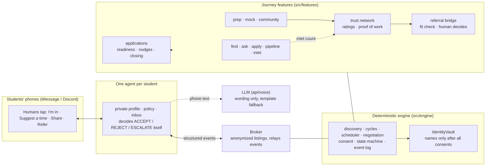

# Hirearchy: hierarchical networking for the job hunt

**Find the job early. Prep with your pipeline. Climb the community ladder. Earn the referral.**

> **Your prep circle becomes your proof of work.** Networking is how students get hired — Hirearchy makes that ladder usable every day.

Live app: **[hirearchy-agents.vercel.app](https://hirearchy-agents.vercel.app)** · Demo: `/app/` · Live Discord: `/app/?live=1`

Every student has a personal AI agent in their messages. It finds roles from company boards (Greenhouse, Lever, Ashby, …) often **minutes after they post** — before they flood LinkedIn — then finds peers to prep and mock with, trades interview intel anonymously, lets you mentor and get mentored for points and reach, and turns all of that into a private **proof of work** an alum can trust. Agents negotiate through structured events; **deterministic code** decides matching, fit, limits and consent; the LLM only words messages; a human is asked before anything that matters: joining, sharing, revealing a name, referring.


Students never see a graph. They see texts and tap **I'm in**, **Suggest a time** or **Not this time**. On **Prep circle** and **Referral**, **How it works** opens the agent graph and event feed for demos.

## Site

- **`/`** — landing (`src/landing/`)
- **`/app/`** — product demo (`src/main.tsx`); logo links home

## The journey

| Tab | What the agent does | Owner |
|---|---|---|
| 🔎 **Find** | Matching roles; **Live search** reads up to 60 of 443 public boards (Greenhouse, Lever, Ashby, SmartRecruiters). Track puts you in that company's pipeline | Aditya (seeded), Sumedha (live) |
| 💬 **Ask** | Ask the network | Aditya |
| 📄 **Apply** | Tailored resume (LaTeX / Overleaf / PDF), intro drafts you send yourself, contacts, tracker | Sumedha |
| 📋 **Applications** | One record per job: readiness, nudges, links to prep / intel / referral / community so the hunt stays connected | Sumedha |
| 📊 **Pipeline** | Anonymous pipeline stats, published only once enough reports back them | Aditya |
| 👥 **Prep circle** | Interview invite → 2–3 peers covering weak spots → negotiate time → names after everyone says yes → calendar, then private ratings | Sumedha |
| 🌱 **Community** | Pay it forward: help requests + project board. Confirmed mentoring earns **points and levels** (reach, packs, mentor profile alumni can trust). Referrals stay a human decision after a chat | Sumedha |
| 🎤 **Mock interview** | Same company + round swap; scores only for the person scored | Sumedha |
| 💡 **Intel** | Give-to-get interview reports, scrubbed of identifying detail | Aditya |
| 🤝 **Referral** | Staged proof of work → coffee chat → **only the alum** taps Refer | Sumedha |

Prep, mocks, intel and community mentoring feed a shared **trust network**. Each student gets a private **proof of work**. Referral reads that record — so daily prep and helping others really change who alumni trust.

## Apply suite: what's live and what's demo

| Feature | Live when | Otherwise | Notes |
|---|---|---|---|
| Live job search (Find → Live search) | Always on Vercel (public job-board APIs need no key) | Seeded postings | Official Greenhouse, Lever, Ashby and SmartRecruiters JSON endpoints only; 443 boards, up to 60 per search |
| Visa and graduation screening | Always (on each posting's text) | n/a | F-1 friendly / needs verification / not eligible and the student's graduation window, each quoting the exact sentence; silence is never assumed friendly |
| Tailored resume (Apply) | Always (runs in the browser) | n/a | Uses only the student's own bullets and skills; lists requirements they don't meet. Starts on a labelled demo profile; paste or type your own |
| LaTeX / Overleaf / PDF | Always | n/a | `.tex` download, Overleaf's documented "open in Overleaf" form, print to PDF; file name "Resume - <Company> - <Role>" |
| Intro email drafts | Always (template) | n/a | `ANTHROPIC_API_KEY` adds Claude rewording that may not add facts. Copy / Gmail / email app only: **we never send email** |
| Contacts | `APOLLO_API_KEY` set | Three contacts labelled "Demo data" | Name, title, company, LinkedIn. No emails from search |
| Huntr | n/a | n/a | **Huntr has no public integration for individual students** (its API is for career centres). Apply → Tracker keeps a status per job (Saved → Applied → OA → Interview → Offer / Rejected) with a summary and interview rate, exports CSV / JSON and links to Huntr |
| Referral packet | Always (demo network) | n/a | After the coffee chat is booked, the referrer can request Jordan's tailored resume + intro; shared only on Jordan's yes |

Research and sources for every integration: [AUDIT.md](AUDIT.md).

## How each feature maps to the judging criteria

**Prep circle** and **Referral** open **How it works** with judging-lens chips that highlight the agent feed:
**⚠ Conflicting constraints**, **↗ What's shared**, **⏸️ When humans are asked**.


### 👥 Prep circle
| Criterion | What you see |
|---|---|
| **Conflicting constraints** | Three students with different evening windows (6:00–9:30, 7:00–9:00, 7:30–10:00 PM). The broker flags the conflict and the agents negotiate the 7:30–9:00 PM overlap. Applicant #6 rejects the evening on its own. Maya counters "8pm?", and every other agent checks 8:00–9:00 PM against its own private hours before it goes back to the humans; a counter that doesn't fit someone is rejected and the old time stands. |
| **What's shared** | Anonymized listings only. Maya's interview date becomes "time-sensitive prep need", Aditya's exact stage is withheld, Applicant #7 (`share_skills=false`) never publishes a listing, and names / emails / Discord ids stay withheld until everyone accepts. |
| **When humans are asked** | Agents settle the schedule themselves (`negotiate_schedule = true`). Joining and revealing identity always escalate. Names are revealed only after **all** members accept; if one declines, the circle dissolves without naming who left and the backup (Jordan) is invited. |

### 🎤 Mock interview
| Criterion | What you see |
|---|---|
| **Conflicting constraints** | Same company and round, at least 60 minutes free together, same difficulty, complementary weak spots first, then the more reliable partner. One agent skips a candidate on a private rule (never a third mock with the same person) without saying why. No one free in your round → practice with your own agent instead. |
| **What's shared** | Anonymous mock listings (round, strengths, weak spots, difficulty). A question pack from anonymized reports. Rubric scores go **only to the person scored** (`ScoreVault` throws for anyone else). |
| **When humans are asked** | Both say "I'm in" before anything is booked; names unlock after both say yes; each human ends their round and scores the other privately; then rates the session. |

### 🤝 Referral Bridge


| Criterion | What you see |
|---|---|
| **Conflicting constraints** | The alum's agent holds **private rules**: SWE / backend roles only, ≥ 2 sessions, rating ≥ 4.5, mock average ≥ 4.0, must meet first, max **2 referrals a month** (demo starts at **2 of 2 left**). Fit check shows ✓/✗ per rule. Theo (★ 4.3) fails the rating rule; after two referrals the monthly limit fails. The 15-minute chat is negotiated by the engine scheduler (7:00–7:15 PM). |
| **What's shared** | Staged: **stage 1** anonymous stats → **stage 2** project links + mock rubric breakdown, only if the fit passes → **stage 3** names, only after both say yes to the chat. A declined seeker hears only "not right now": no rule, threshold or referrer name, and the referrer never learns theirs. |
| **When humans are asked** | The seeker OKs sharing at all; both OK the chat; after the chat **only the referrer's human** can choose 🤝 Refer / 🕗 Not yet (with a coaching note, e.g. "Do one more system design mock first.") / No. Agents never refer on their own (`decide()` is the only path and throws for anyone else). Referrers earn give-back credit. |

### 🌱 Pay it forward (Community)
| Criterion | What you see |
|---|---|
| **Conflicting constraints** | Priya has nothing to trade, so no circle forms; her need stays open. Each mentor's agent checks its human's **private capacity rules** (topics, newcomers per week, evenings only): Leo doesn't teach DSA, Sam already has 2 of 2 newcomers this week, Aditya fits at 7:30–8:15 PM. A mentor gets one ask at a time; higher-level askers are matched first. On the project board, the senior's private shortlist rules and a hard weekly hours cap decide who fits. |
| **What's shared** | The listing has a handle, company, round, topic and "this week": no name, no exact date. Capacity checks and shortlist decisions go only to the mentor's own agent. Names unlock through the engine's consent-gated identity vault after both say yes. Points never appear in the evidence file; referrers see "helped N newcomers" instead. |
| **When humans are asked** | Both humans say yes before anyone meets; both confirm the session happened before points count; both rate privately. Seniors pick, juniors choose to join and can leave anytime. |

### 🏅 Trust and proof of work (Prep circle + Mock interview)
| Criterion | What you see |
|---|---|
| **Conflicting constraints** | Reliability breaks ties in mock matching; a no-show counts against it. |
| **What's shared** | No individual rating is ever returned, not even to the person rated: only a count, and a reliability score once there are ≥ 2 ratings. The evidence file is readable only by its owner and leaves their agent only through staged disclosure. |
| **When humans are asked** | Each member rates the others privately after the session (showed up? helpful 1–5?). |

### 🔎 Find · 📊 Pipeline · 💡 Intel (Aditya)
| Criterion | What you see |
|---|---|
| **Conflicting constraints** | Find: postings against your role and level filters. Pipeline: you want numbers, but each stat stays hidden until it has ≥ 3 reports. Intel: give-to-get access versus a 48-hour grace period. |
| **What's shared** | Find: match reasons built from the posting, never your data. Pipeline: aggregate counts only; a hidden stat has no number at all. Intel: emails, phone numbers, @handles and exact dates are scrubbed; dates become "this week". |
| **When humans are asked** | Find: nothing is tracked until you tap "Track it". Intel: you choose to write a report and what goes in it. |

## Pay it forward

Newcomers have nothing to trade yet, so a prep circle can't form for them. In the **Community** tab their agent posts
a standing, anonymous help request instead, and mentors earn points and levels for helping.

**Points build reach and trust — they are earned, never spent.** Levels unlock matching priority, a badge on your
proof of work, and question packs: a stronger mentor profile. Helping beginners pays more (3× newcomers, 2× a level
below). Alumni who hire can trust people with that standing; a referral still comes only from the referrer's own
decision after a chat (Referral tab). Referrers see mentoring outcomes ("helped 2 newcomers, ★ 4.8"), never a
points balance you can cash in.

| Rule | Why |
|---|---|
| Base 10 points; helping a newcomer 3x, someone a level below 2x, a peer 1x | Rewards helping people who have the least |
| Points only after **both** sides confirm the session happened | No points for a session that didn't happen |
| One pair earns points at most twice a week (either direction) | Two friends can't farm points off each other |
| Newcomer status ends after 3 completed sessions | The 3x bonus can't be farmed forever |
| Saying no never costs points | No pressure to accept; capacity rules stay private |
| Only the helper earns; a mentor gets one ask at a time | No points for being helped; no flooding a mentor |
| Levels: Newcomer 0, Contributor 30, Mentor 100, Senior mentor 250 | Perks only: priority, badge, packs (1, 3, all) |
| Projects: hours capped per junior per week; juniors leave anytime and keep their credit and points | Seniors can't overload juniors; leaving is free |

All of it is deterministic code (`src/features/community/points.ts`, `community.ts`, `projects.ts`); no model decides a
point, a match or an unlock. Question packs are copied word for word from the anonymized mock and intel reports, each
item labelled with its source; there is no pack for a company with no reports.

## Privacy proof

Privacy is enforced in the data layer, not just hidden in the UI. Names, emails and Discord ids live in an
`IdentityVault`, and the only way to read them is `getIdentity()`, which throws until every member has consented.
Ratings live in a ledger with no method that returns one. Mock scores live in a vault only the person scored can
read. The referrer's fit check is addressed to the referrer's agent only.

The badge in the app ("🔒 Privacy proof · … · N/N tests passing") comes from a real test run.

**Sabotage tests:** `npm run test:sabotage` plants a privacy bug, runs the whole suite, and requires the tests to
catch it, for twelve bugs, one at a time, restoring the code after each:

```
✓ caught   Broker names the decliner when dissolving
✓ caught   Broker reveals at 2 of 3 consents
✓ caught   Identity gate removed from the vault
✓ caught   Listing carries the private name
✓ caught   Interview date shared raw instead of abstracted
✓ caught   share_skills=false agent still publishes a listing
✓ caught   Rating leak: trust summary carries the individual ratings
✓ caught   Referral auto-approved by the agent after the chat
✓ caught   Evidence file (links + rubric) sent at stage 1, before the fit check
✓ caught   Mock scores readable by anyone, without the subject's grant
✓ caught   Outreach draft auto-sent without the student
✓ caught   Resume export adds skills the student never listed

All 12 privacy sabotages were caught.
```

## How to run

```bash
npm install
npm run dev            # landing page at http://localhost:5173/, demo app at /app/ (runs the tests first to refresh the badge)
npm test               # all unit tests
npm run demo:run       # prints the prep-circle golden path and the backup branch, no browser needed
npm run test:sabotage  # the privacy sabotage tests
```

Requires Node 20.19+ (or 22.12+). Everything runs in memory. No keys are needed locally: `npm run dev` doesn't
serve the `api/` functions, so notifications and Claude wording quietly fall back and the demo works end to end.

## Deployment (Vercel)

Import the repo into Vercel. The defaults work as they are: framework **Vite**, build command `npm run build`,
output `dist`. The serverless functions in `api/` are picked up automatically; there is no `vercel.json`.

| Function | Does | Needs | Without it |
|---|---|---|---|
| `api/voice.ts` | Words a phone message with Claude (only when `VITE_USE_LLM_COPY=true`) | `ANTHROPIC_API_KEY` | Responds 503; the browser uses a template within 3 s |
| `api/notify.ts` | Posts Aditya's "needs you" messages to Discord | `DISCORD_WEBHOOK_URL` | Responds 503; skipped silently |
| `api/jobs-search.ts` | Live search: reads up to 60 public job boards (7 s budget, 10 min cache) | nothing (set `JOBS_SEARCH=off` to disable) | The Find tab shows the seeded postings, labelled "Demo data" |
| `api/outreach-draft.ts` | Intro email draft; Claude rewording only if it adds no facts | `ANTHROPIC_API_KEY` (optional) | Template draft (always under 120 words) |
| `api/apollo-search.ts` | Recruiters and people in the target role at a company (Apollo People API Search) | `APOLLO_API_KEY` | Three contacts labelled "Demo data" |

### Environment variables

| Variable | Where | Required | Purpose |
|---|---|---|---|
| `ANTHROPIC_API_KEY` | Server (Vercel env) | Optional | Claude wording for phone messages via `/api/voice` |
| `DISCORD_WEBHOOK_URL` | Server (Vercel env) | Optional | Discord notification for Aditya's "needs you" messages via `/api/notify` |
| `APOLLO_API_KEY` | Server (Vercel env) | Optional | Real contacts in Apply → Outreach (Apollo's People API Search: 0 credits, no emails) |
| `OUTREACH_MODEL` | Server (Vercel env) | Optional | Claude model for outreach rewording (default `claude-sonnet-5-5`) |
| `JOBS_SEARCH` | Server (Vercel env) | Optional | `off` disables live job search |
| `VITE_USE_LLM_COPY` | Build time | Optional, default off | `true` = phone messages worded by Claude; off = the built-in student copy. Only turn on with `ANTHROPIC_API_KEY` set. Redeploy after changing it (it's baked into the build). |

### Live Discord mode (optional)

Open the demo app with `/app/?live=1` (`/?live=1` redirects there) and Aditya's agent really DMs them in Discord with **✅ I'm in · 🕗 Suggest a time ·
Not this time** buttons; their answer drives the demo exactly like a tap on their simulated phone. Without `?live=1`, or
if anything fails, the page says "Live mode unavailable, using simulated phone" and carries on. Full setup:
**[LIVE_DISCORD.md](LIVE_DISCORD.md)**. It adds three functions (`api/live-notify.ts`, `api/live-state.ts`,
`api/discord-interactions.ts`), one Supabase migration (`supabase/live.sql`) and these server-only variables:

| Variable | Secret? | Purpose |
|---|---|---|
| `DISCORD_APP_ID` | no | The Discord application |
| `DISCORD_PUBLIC_KEY` | no | Verifies Discord's signature on every interaction |
| `DISCORD_BOT_TOKEN` | **yes** | Sends the DM |
| `DISCORD_ADITYA_USER_ID` | no | The only person the bot DMs and accepts clicks from |
| `SUPABASE_URL` | no | Where replies wait for the page (`VITE_SUPABASE_URL` also works) |
| `SUPABASE_SERVICE_ROLE_KEY` | **yes** | Server-side access to the `t2_live_*` functions |

`VITE_SUPABASE_URL` / `VITE_SUPABASE_ANON_KEY` are listed in `.env.example` but not used yet:
`supabase/track2.sql` is written and not connected. Never commit real values; `.env*` files are git-ignored
except `.env.example`.

## Demo steps

The top bar has the speed control (**Slow** for a live presentation, **Fast** for a run-through) and **↺**, which
resets every tab at once. Tabs keep their state while you switch between them.

### 👥 Prep circle (default tab)
1. Pick **Slow** (top right) for a live presentation, or **Fast** for a quick run-through.
2. Click **📩 Aditya just got a Microsoft interview invite →**. Or click **Paste a real invite**, paste e.g.
   *"We would like to invite you to interview for the Software Engineer Intern role at Microsoft."* and press
   **Check invite**. (An invite for another company is recognised but doesn't start a run, since only the
   Microsoft SWE Intern network is seeded.)
3. Aditya's phone says congrats while the agent works. Open **How it works** to watch the agent feed live, then close it.
4. On **Maya's phone**, tap **Suggest a time → 8:00 PM**. The other agents check the new window against private hours.
5. Tap **I'm in** on all three phones. Names unlock; each phone gets a calendar invite; **Add to calendar** downloads the .ics. Then rate privately (showed up? helpful 1–5?).
6. In **How it works**, toggle the judging-lens chips. Press **↺** and tap **Not this time** on Maya for the backup branch (Jordan appears; nobody is named as the decliner).

### 🎤 Mock interview
Click **🎤 Aditya's Microsoft technical round is Thursday →**. Tap **✅ I'm in** on both phones; each gets a question
pack, the rounds run on a timer (**End round**), each scores the other privately, then rates the session and sees
their proof of work. **No one in your round?** shows the practice-with-your-agent fallback.

### 🤝 Referral
1. Click **Jordan applied to Stripe SWE Intern →**. On Jordan's phone tap **Share my stats**.
2. Nadia's phone shows anonymous stats, the private fit check, then project links and rubric. Both tap **I'm in** for the coffee chat; names unlock.
3. Nadia taps **We had the chat**, then **Refer** / **Not yet** / **No**. **Refer** uses one of **2 of 2** monthly slots and earns +1 give-back credit (**1 of 2 left** afterward).
4. **Next applicant: Theo →** keeps Nadia's month. From idle, **Not a fit? See Theo's application** shows the rating failure alone.
5. **How it works** shows fit per rule, staged disclosure, and referrals left.

### 🌱 Community (Pay it forward)
1. Click **Priya, a freshman, needs help with DSA for Microsoft →**. Her agent posts an anonymous request and gives a starter pack. Side card shows points, levels and perks (reach / packs / mentor profile).
2. Click **A mentor comes online →**. Aditya's agent checks private capacity rules and asks him. With `?live=1`, that ask is a real Discord DM.
3. Both tap **I'm in** → calendar → **We had the session** on both phones.
4. Aditya earns **+30 (10 × 3, helped a newcomer)**, levels up, unlocks packs; both rate privately; proof of work updates. Points raise trust and reach — they do not purchase a referral.
5. **Project board** → **Sam posts a project**: anonymous apply → shortlist → join → log hours → confirm week → leave anytime.

### 📄 Apply and live search
1. Find → turn on **Live search** (top right), pick a level, **Search live boards**, then **Track** a posting. The agent
   offers the prep circle, a mock swap, a referral, or a tailored resume.
2. Apply → the tracked posting is selected: the phone says how many of your bullets it used and which requirements you
   don't show yet. **Download LaTeX**, **Open in Overleaf** or **Save as PDF**.
3. **Outreach** → **Find contacts**, pick one, **Write draft**, then Copy / Open in Gmail / Email app. **Tracker** →
   export CSV or JSON. **See what the agent is doing** lists every step with what was shared, summarized and hidden.
4. In Referral, after both say yes to the chat, Nadia can **Request resume and intro**; Jordan decides whether to share.

## Architecture



- **Agents and broker:** each student's agent holds its own private data and decides against it; the broker only
  sees anonymized listings and relays events. Nobody's agent reads another's private data.
- **Deterministic engine, reused by every feature:** matching, scheduling, negotiation, consent, identity and the
  state machines are plain, tested TypeScript. Each feature (mock, referral) has its own state machine on the same
  transition rules, and runs are reproducible (↺ restores every tab exactly).
- **Trust network:** one per journey, keyed by person, fed by prep circles and mocks, read by the referral bridge.
  It never returns an individual rating.
- **LLM only for language:** Claude (`api/voice.ts`, opt-in via `VITE_USE_LLM_COPY`) only words messages to
  humans. It never decides a match, a time, a fit, a limit or a consent. Templates by default; the demo works
  offline.

Code map: `src/engine/`, `src/features/` (`find`, `ask`, `apply`, `journey`, `pipeline`, `prep`, `community`, `mock`,
`intel`, `trust`, `referral`), `src/ui/`, `src/live/` + `api/live-*` + `api/discord-interactions.ts`,
`src/integrations/` + `api/{voice,notify,jobs-search,...}.ts`, `scripts/`, `tests/`, `supabase/live.sql`.

## Team

- **Sumedha:** engine, journey shell, Applications, prep, community, mock, trust, Referral Bridge, live Discord
- **Aditya:** Find / Ask / Pipeline / Intel, integrations and deployment support
