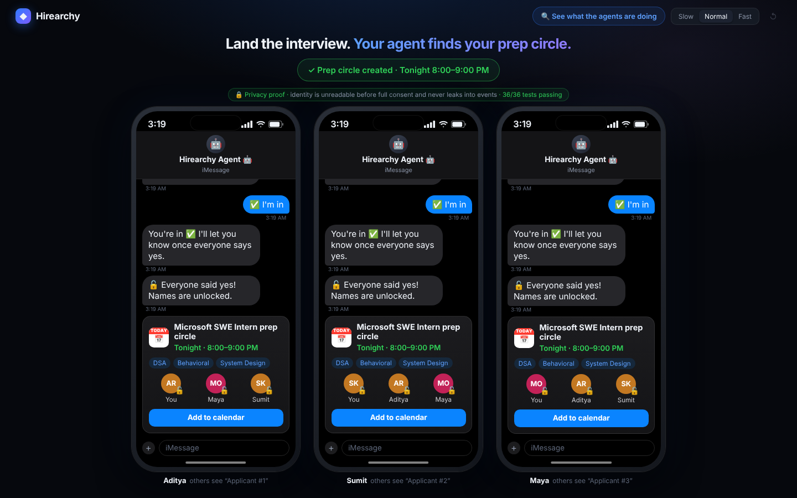
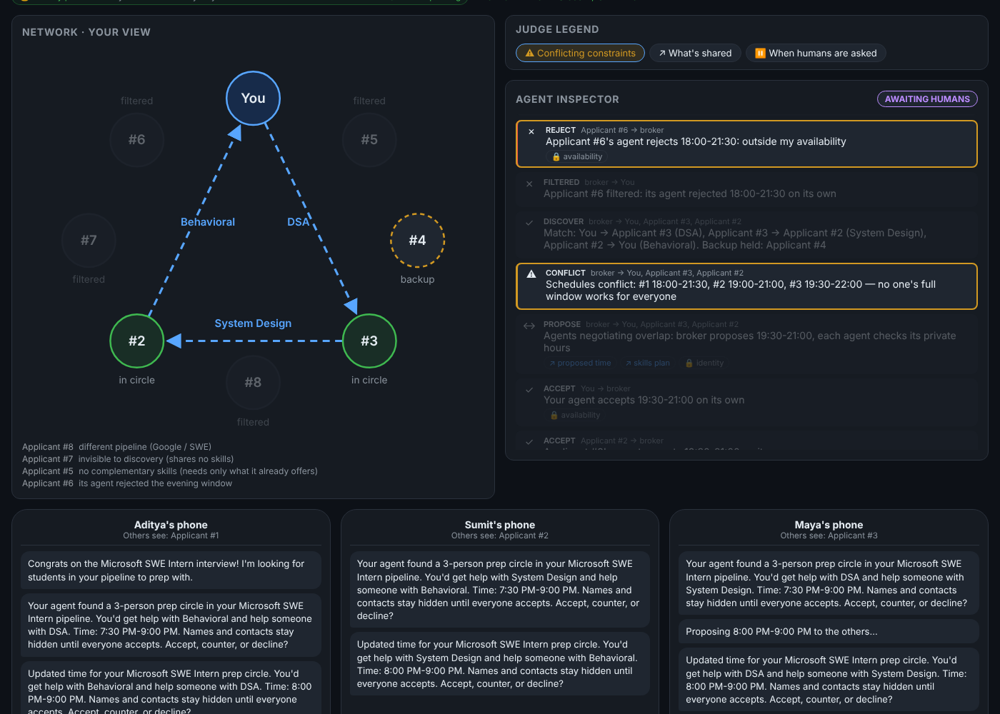
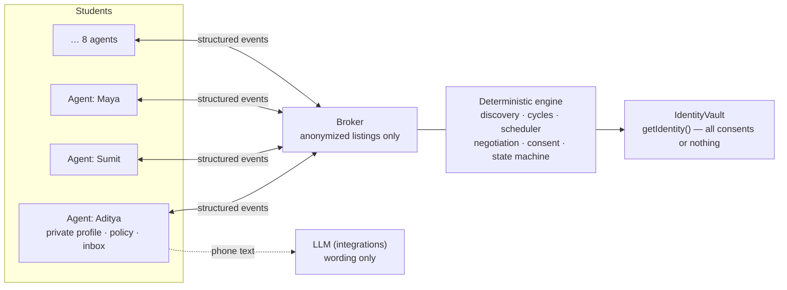

# Hirearchy Agents

**The moment a student lands an interview, their personal AI agent finds other students in the same hiring
pipeline who can cover their weak spots (while they cover others'), negotiates a time with those students'
agents, and shares names only once everyone says yes.**

> Track 1 built the applicant network. Track 2 makes the network work for you.



Students never see a graph. Their agent lives in their messages (iMessage via Cubbie, or Discord): it texts them
when it found a circle, they tap **✅ I'm in**, **🕗 Suggest a time** or **Not this time**, and they get a calendar
invite once everyone says yes. The graph and the agents' conversation sit behind **🔍 See what the agents are doing**,
for judges.

## How it maps to the judging criteria

Open **🔍 See what the agents are doing**. The drawer has one judging-lens chip per criterion; clicking one
highlights those events in the live agent conversation.



| Criterion | Chip | What you see in the golden path |
|---|---|---|
| **Conflicting constraints** | ⚠ Conflicting constraints (CONFLICT / COUNTER / REJECT) | Three students with different evening windows (18:00-21:30, 19:00-21:00, 19:30-22:00). The broker flags the conflict and the agents negotiate the 19:30-21:00 overlap. Applicant #6 rejects the evening window on its own. Maya counters "8pm?", and every other agent checks 20:00-21:00 against its own private hours before it's sent back to the humans. A counter that doesn't fit someone is rejected, and the old time stands. |
| **What's shared** | ↗ What's shared (any disclosure) | Every event lists what was **↗ shared**, **≈ abstracted** and **🔒 withheld**. Maya's interview date becomes "time-sensitive prep need", Aditya's exact stage is withheld, Applicant #7 (`share_skills=false`) never publishes a listing, and names / emails / Discord ids stay withheld until the end. |
| **When humans are asked** | ⏸️ When humans are asked (ESCALATE / CONSENT) | Agents settle the schedule on their own (`negotiate_schedule = true`). Joining a circle and revealing your identity always escalate to the human, who gets a notification and answers in the chat: ✅ I'm in / 🕗 Suggest a time / Not this time. Names are revealed only after **all** members accept. If one declines, the circle dissolves without naming who left, and the agent finds the backup (Jordan). |

## Privacy proof

Privacy is enforced in the engine's data layer, not just hidden in the UI. Names, emails and Discord ids live in
an `IdentityVault`, and the only way to read them is `getIdentity()`, which throws until every member of the
circle has consented.

The badge in the app ("🔒 Privacy proof · … · N/N tests passing") comes from a real test run.

**Sabotage tests:** `npm run test:sabotage` plants a privacy bug in the engine, runs the suite, and requires the
tests to catch it. It does this for six bugs, one at a time, and restores the original code after each one:

```
✓ caught   Broker names the decliner when dissolving
✓ caught   Broker reveals at 2 of 3 consents
✓ caught   Identity gate removed from the vault
✓ caught   Listing carries the private name
✓ caught   Interview date shared raw instead of abstracted
✓ caught   share_skills=false agent still publishes a listing

All 6 privacy sabotages were caught.
```

The leak-scan test serializes the entire event log before the reveal and checks that no name, email or Discord id
appears anywhere in it.

## How to run

```bash
npm install
npm run dev            # the app, at http://localhost:5173 (runs the tests first to refresh the badge)
npm test               # all unit tests (engine, UI view model, integrations and api/ handlers)
npm run demo:run       # prints the golden path and the backup branch as event lines, no browser needed
npm run test:sabotage  # the privacy sabotage tests
```

Requires Node 20.19+ (or 22.12+). The engine runs fully in memory. No keys are needed locally: `npm run dev`
doesn't serve the `api/` functions, so notifications and Claude wording quietly fall back and the demo works
end to end.

## Deployment (Vercel)

Import the repo into Vercel. The defaults work as they are: framework **Vite**, build command `npm run build`,
output `dist`. The two serverless functions in `api/` are picked up automatically; there is no `vercel.json`.

| Function | Does | Needs | Without it |
|---|---|---|---|
| `api/voice.ts` | Words a phone message with Claude (only when `VITE_USE_LLM_COPY=true`) | `ANTHROPIC_API_KEY` | Responds 503; the browser uses a template within 3 s |
| `api/notify.ts` | Posts Aditya's "needs you" messages to Discord | `DISCORD_WEBHOOK_URL` | Responds 503; skipped silently |

### Environment variables

| Variable | Where | Required | Purpose |
|---|---|---|---|
| `ANTHROPIC_API_KEY` | Server (Vercel env) | Optional | Claude wording for phone messages via `/api/voice` |
| `DISCORD_WEBHOOK_URL` | Server (Vercel env) | Optional | Discord notification for Aditya's "needs you" messages via `/api/notify` |
| `VITE_USE_LLM_COPY` | Build time | Optional, default off | `true` = phone messages worded by Claude; off = the built-in student copy. Only turn on with `ANTHROPIC_API_KEY` set. Redeploy after changing it (it's baked into the build). |

`VITE_SUPABASE_URL` / `VITE_SUPABASE_ANON_KEY` are listed in `.env.example` but not used yet:
`supabase/track2.sql` is written and not connected. Never commit real values; `.env*` files are git-ignored
except `.env.example`.

## Demo steps

1. Pick **Slow** (top right) for a live presentation, or **Fast** for a quick run-through.
2. Click **📩 Aditya just got a Microsoft interview invite →**. Or click **Paste a real invite**, paste e.g.
   *"We would like to invite you to interview for the Software Engineer Intern role at Microsoft."* and press
   **Check invite**. (An invite for another company is recognised but doesn't start a run, since only the
   Microsoft SWE Intern network is seeded.)
3. Aditya's phone says congrats while the agent works. Open **🔍 See what the agents are doing** to watch it live:
   8 agents found → #8 filtered (other pipeline) → #7 invisible (private profile) → #5 filtered (same skill only)
   → #6 rejects the evening on its own → circle **You → #3 (DSA) → #2 (System Design) → You (Behavioral)**, #4
   held as backup → ⚠ schedules conflict → agents negotiate → ✓ window agreed, 7:30–9:00 PM. Close the drawer.
4. A notification slides down on all three phones. On **Maya's phone**, tap **🕗 Suggest a time → 8:00 PM**. The
   other agents check 8:00–9:00 PM against their private hours, and everyone gets the new time.
5. Tap **✅ I'm in** on all three phones. Names unlock 🔓, each phone gets a calendar invite with the circle, and
   **Add to calendar** downloads the .ics.
6. In the drawer, toggle the judging-lens chips to walk through each criterion. Click a "Shared · Summarized ·
   Hidden" line to see exactly what an agent disclosed.
7. Press the faint **↺** (top right) to reset, start again, and tap **Not this time** on Maya's phone for the
   backup branch: the circle dissolves, nothing is revealed, nobody is told who left, and Jordan's phone appears
   with a new circle at 7:00–9:00 PM.

## Architecture



- **Agents:** one `Agent` instance per student. Each holds its own private profile, policy and inbox, and decides
  ACCEPT / REJECT / ESCALATE itself against its private data. Agents talk only through structured events.
- **Broker:** neutral. It receives anonymized listings built from each agent's policy, finds 2- and 3-person
  cycles, and relays events. It never reads a private profile and never decides for anyone.
- **Deterministic engine:** matching, scheduling, permissions, consent and every state transition are plain,
  tested TypeScript in `src/engine/`. An explicit state machine rejects invalid transitions, and runs are
  byte-identical (`resetDemo()` reproduces a run exactly).
- **LLM only for language:** Claude (`api/voice.ts`, opt-in via `VITE_USE_LLM_COPY`) only words messages to
  humans. It never decides a match, a time, a permission or a consent, and identity fields are stripped from
  what it sees until the reveal. Invite parsing is deterministic pattern matching. Every message has a template
  fallback, so the demo works offline.

Code map: `src/engine/` (seed, agents, broker, pure modules), `src/ui/` (iMessage phones, under-the-hood drawer
with graph and agent feed, student copy, `integrations.ts` adapter with `integrationsStub.ts` as fallback),
`src/integrations/` (invite parsing, .ics, message generation and notifications), `api/` (Vercel functions for
Claude and Discord), `scripts/` (`demo:run`, test badge, sabotage tests), `tests/`, `supabase/track2.sql` (additive
`t2_` schema with RLS on and access through functions only; written, not yet connected).

## Team

- **Sumedha:** coordination engine, privacy model and tests, UI (`src/engine/`, `src/ui/`, `scripts/`)
- **Aditya:** integrations and deployment: invite parsing, .ics calendar files, Claude message wording and
  Discord notifications (`src/integrations/`, `api/`, `tests/integrations/`)
