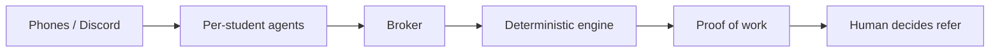

# Hirearchy

Personal AI agents for students on the job hunt — they find peers in the same pipeline, negotiate prep and mocks, trade intel, mentor across years, and turn that into proof of work an alum can trust before a referral.

**Live:** [hirearchy-agents.vercel.app](https://hirearchy-agents.vercel.app) · **App:** [/app/](https://hirearchy-agents.vercel.app/app/) · **Discord live:** `/app/?live=1`


## Why students need this

Getting a job as a student is mostly networking: who will prep with you, who will share what the interview was like, who will vouch for you. Today that means cold LinkedIn messages, scattered Discord servers, and tools that only solve one slice (autofill, mock practice, or an alumni directory).

Hirearchy is the **networking ladder** students can use every day: early roles from company boards, prep with people in your pipeline, help juniors and climb levels, share intel, and earn referrals from alumni who already see your proof of work. Agents do the awkward matching and scheduling; students keep the decisions.

## How this fits Track 2

Track 2 asks for personal AI agents on campus that **work with each other**, exchange what matters, and reach a shared outcome — while showing **conflicting constraints**, **what is shared**, and **when humans confirm**.

| Track ask | Hirearchy |
|---|---|
| Real campus scenario | Interview prep and peer networking around intern / new-grad recruiting (study-group energy, hiring stakes) |
| Agents work with each other | One agent per student; a broker relays anonymized listings; agents negotiate times, fit, and capacity |
| Conflicting constraints | Different evening windows, pipelines, capacity rules, monthly referral limits, “must meet first” |
| What they share | Anonymized skills / stage / intel only; names stay locked until mutual consent; ratings never leak as singles |
| When students confirm | Join a circle or mock, share stats with an alum, reveal identity, confirm a session happened, **Refer** |
| Messaging surface | iMessage-style UI in the app; optional real Discord DMs (`?live=1`) |
| Framework | Open source stack (React, TypeScript, Vite); deterministic engine in-repo — not Cubbie |

In the app, **How it works** on Prep circle and Referral highlights those three lenses on the live agent feed: conflicting constraints, what’s shared, when humans are asked.

## What the product does

| Area | Shared outcome |
|---|---|
| **Find · Apply · Applications** | Surface fresh Greenhouse / Lever / Ashby / SmartRecruiters postings; tailor a resume; one record per job with readiness nudges |
| **Prep circle** | After an invite, agents form a 2–3 person prep group that covers weak spots, negotiate a time, unlock names only when everyone says yes |
| **Mock interview** | Swap interviewer / interviewee with someone in the same company and round; scores stay private to the person scored |
| **Intel** | Give-to-get anonymized interview reports for your pipeline |
| **Community** | Newcomers ask for help; mentors’ agents check private capacity; confirmed help earns points and levels (reach, packs, mentor profile — not a purchasable referral) |
| **Referral** | Alum’s agent fit-checks anonymous proof of work in stages; coffee chat; only the human taps Refer |
| **Trust** | Prep, mocks, intel, and mentoring feed one private proof-of-work file the referral bridge can read |

## What’s already out there — and the gap

| Space | Examples | Missing for this track |
|---|---|---|
| Job boards | Handshake | No multi-agent prep or earned referral loop |
| Apply tools | Simplify, Teal, Huntr | Faster applications, not agent-to-agent campus coordination |
| Mocks | Aced, interviewing.io | Practice alone; no shared outcome with peers’ agents |
| Reviews | Glassdoor, Blind | Static dumps; no consent-gated peer agents |
| Mentoring platforms | PeopleGrove, UniBuzz, Aphinity | Directory matching; not private capacity rules + proof of work |
| Paid intros | PartnerHQ, intro.market | Buy warm intros — not student agents earning trust |

Hirearchy connects the ladder those tools leave separate: **early jobs → daily prep with peers → community standing → human referral**.

## Multi-agent design (short)

- Each student has an agent with **private** profile, policy, and rules.
- The **broker** only sees anonymized listings and relays structured events.
- **Deterministic code** decides match, schedule, fit, limits, and consent. An optional LLM only words messages.
- **IdentityVault**, rating ledger, and mock score vault enforce privacy in data, not only in the UI. `npm run test:sabotage` plants twelve leaks and requires the suite to catch each.



## Tech stack

React 19 · TypeScript · Vite · Vitest · Vercel (`api/` serverless) · optional Anthropic (wording) · optional Discord + Supabase for live DMs.

Notable paths: `src/engine/`, `src/features/`, `api/jobs-search.ts`, `src/live/` + [LIVE_DISCORD.md](LIVE_DISCORD.md). Integration notes: [AUDIT.md](AUDIT.md).

## Run locally

```bash
npm install
npm run dev    # http://localhost:5173/  →  /app/
npm test
```

No API keys required for the core demo. Optional env: `.env.example`.

## Team

- **Sumedha** — engine, journey / Applications, prep, community, mock, trust, referral, live Discord  
- **Aditya** — Find, Ask, Pipeline, Intel, integrations
