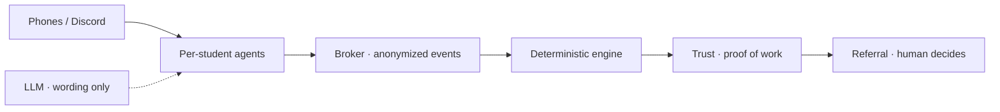

# Hirearchy

**The networking ladder for students: climb by helping others, earn referrals alumni trust.**

[Live app](https://hirearchy-agents.vercel.app) · [Open product](https://hirearchy-agents.vercel.app/app/) · Optional Discord live mode: `/app/?live=1`


## Pitch

Networking is how students get jobs — not another keyword score or autofill button. Hirearchy is **hierarchical networking**: find roles early, prep every day with your pipeline, mentor and get mentored for points and reach, share intel, and turn that into **proof of work** an alum can trust. Agents match and negotiate in the background; **humans keep every decision that matters** (join, share a name, refer). Points raise visibility and trust — they never buy a referral.

## What you get

| Surface | Why it matters daily |
|---|---|
| **Find** | Live roles from Greenhouse, Lever, Ashby, SmartRecruiters (443 boards) — often minutes after post, before LinkedIn floods |
| **Apply · Applications** | Tailored resume, outreach drafts, tracker; one hub per job with readiness and next-step nudges |
| **Prep circle · Mock · Intel** | Same-pipeline practice, give-to-get intel, private ratings → proof of work |
| **Community** | Help requests + project board; points/levels for helping (beginners earn mentors more); packs and mentor profile |
| **Referral** | Staged anonymous proof → coffee chat → **only the alum** taps Refer |

Students see iMessage-style phones, not graphs. **How it works** (Prep + Referral) shows the agent feed for demos and review.

## Competitive research — what exists, what doesn’t

We mapped the student career stack:

| Cluster | Examples | What they do | Gap |
|---|---|---|---|
| Job boards / campus | Handshake | Jobs + light alumni connect | No earned proof → referral loop |
| Autofill / trackers | Simplify, Teal, Huntr | Apply faster, CRM the hunt | No privacy-gated peer agents or trust ladder |
| Peer / expert mocks | Aced (ex-Pramp), interviewing.io | Practice only | Not wired to referrals or community standing |
| Review dumps | Glassdoor, Blind, Levels.fyi | Static intel / pay | No give-to-get cohort intel |
| Uni mentoring | PeopleGrove, Mentor Spaces, UniBuzz, Aphinity | Match + intros | Institutional directories, not agent consent + proof of work |
| Paid intros | PartnerHQ, intro.market | **Buy** warm intros | Opposite of earned, human-decided referrals |

**Nobody** connects: early board jobs → daily prep → mentoring ladder → portable proof of work → human referral. That end-to-end ladder is Hirearchy.

## Why it’s unique

1. **Hierarchical networking** — climb by helping (3× for newcomers); levels unlock reach, packs, mentor profile alumni can trust.
2. **Proof of work, not cold DMs** — prep sessions, mocks, intel, mentoring ratings feed one evidence file Referral can fit-check anonymously.
3. **Privacy in the data layer** — names stay in an identity vault until mutual consent; ratings and mock scores never leak as singles; agents never auto-refer.
4. **Deterministic agents** — matching, fit, limits, and consent are tested TypeScript; the LLM only words messages (optional).
5. **Early jobs** — official public board APIs so students hit the stack while it’s still short.

## Tech stack

| Layer | Choice |
|---|---|
| App | React 19, TypeScript, Vite |
| Hosting | Vercel (static `/` + `/app/`, serverless `api/`) |
| Agent engine | In-repo deterministic broker (`src/engine/`) — discovery, schedule, consent, `IdentityVault` |
| Product surfaces | `src/features/` — find, apply, journey, prep, community, mock, intel, trust, referral, ask |
| Live jobs | `api/jobs-search.ts` → Greenhouse / Lever / Ashby / SmartRecruiters JSON |
| Optional AI | Anthropic Claude via `api/voice` / outreach (wording only) |
| Optional Discord | Bot + Supabase (`supabase/live.sql`) — [LIVE_DISCORD.md](LIVE_DISCORD.md) |
| Quality | Vitest; `npm run test:sabotage` plants 12 privacy bugs and requires the suite to catch each |



Integration research and API notes: [AUDIT.md](AUDIT.md). Build journal: [PROGRESS.md](PROGRESS.md).

## Privacy (judge-ready)

Identity, ratings, and mock scores are gated in code — not just hidden in CSS. Sabotage suite must catch leaks (decliner named, early reveal, auto-refer, score vault bypass, …). Badge in-app reflects a real test run.

## Try it

```bash
npm install
npm run dev    # http://localhost:5173/  →  /app/
npm test
```

No keys required locally. Production: [hirearchy-agents.vercel.app](https://hirearchy-agents.vercel.app). Optional env (Claude, Apollo, Discord, Supabase) is documented in `.env.example` and [LIVE_DISCORD.md](LIVE_DISCORD.md).

## Team

- **Sumedha** — engine, journey / Applications, prep, community, mock, trust, referral, live Discord  
- **Aditya** — Find, Ask, Pipeline, Intel, integrations
