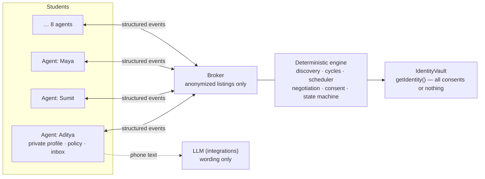

# Hirearchy Agents

**The moment a student lands an interview, their personal AI agent finds other students in the same hiring
pipeline who can cover their weak spots (while they cover others'), negotiates a time with those students'
agents, and shares names only once everyone says yes.**

> Track 1 built the applicant network. Track 2 makes the network work for you.


## How it maps to the judging criteria

The **Judge legend** above the Agent Inspector has one toggle chip per criterion. Clicking one highlights those
events in the live feed.


| Criterion | Chip | What you see in the golden path |
|---|---|---|
| **Conflicting constraints** | ⚠ Conflicting constraints (CONFLICT / COUNTER / REJECT) | Three students with different evening windows (18:00-21:30, 19:00-21:00, 19:30-22:00). The broker flags the conflict and the agents negotiate the 19:30-21:00 overlap. Applicant #6 rejects the evening window on its own. Maya counters "8pm?", and every other agent checks 20:00-21:00 against its own private hours before it's sent back to the humans. A counter that doesn't fit someone is rejected, and the old time stands. |
| **What's shared** | ↗ What's shared (any disclosure) | Every event lists what was **↗ shared**, **≈ abstracted** and **🔒 withheld**. Maya's interview date becomes "time-sensitive prep need", Aditya's exact stage is withheld, Applicant #7 (`share_skills=false`) never publishes a listing, and names / emails / Discord ids stay withheld until the end. |
| **When humans are asked** | ⏸️ When humans are asked (ESCALATE / CONSENT) | Agents settle the schedule on their own (`negotiate_schedule = true`). Joining a circle and revealing your identity always escalate to the human, who answers on their phone with Accept / Counter / Decline. Names are revealed only after **all** members accept. If one declines, the circle dissolves without naming who left, and the agent finds the backup (Jordan). |

## Privacy proof

Privacy is enforced in the engine's data layer, not just hidden in the UI. Names, emails and Discord ids live in
an `IdentityVault`, and the only way to read them is `getIdentity()`, which throws until every member of the
circle has consented.

The badge in the app ("🔒 Privacy proof · … · N/N tests passing") comes from a real test run.

**Sabotage tests:** `npm run test:sabotage` plants a privacy bug in the engine, runs the suite, and requires the
tests to catch it. It does this for six bugs, one at a time, and restores the original code after each one:

```
✓ caught   Broker names the decliner when dissolving
✓ caught   Broker reveals at 2 of 3 consents
✓ caught   Identity gate removed from the vault
✓ caught   Listing carries the private name
✓ caught   Interview date shared raw instead of abstracted
✓ caught   share_skills=false agent still publishes a listing

All 6 privacy sabotages were caught.
```

The leak-scan test serializes the entire event log before the reveal and checks that no name, email or Discord id
appears anywhere in it.

## How to run

```bash
npm install
npm run dev            # the app, at http://localhost:5173 (runs the tests first to refresh the badge)
npm test               # unit tests (engine, view model, integration stubs)
npm run demo:run       # prints the golden path and the backup branch as event lines, no browser needed
npm run test:sabotage  # the privacy sabotage tests
```

Requires Node 20.19+ (or 22.12+). Everything runs in memory; no keys or network are needed.

## Demo steps

1. Pick **Slow** for a live presentation (or **Fast** for a quick run-through).
2. Click **📩 Simulate interview invite**, or paste an invite into **📩 Paste an interview invite**, e.g.
   *"We would like to invite you to interview for the Software Engineer Intern role at Microsoft."*
   (An invite for another company is recognised but doesn't start a run, since only the Microsoft SWE Intern
   network is seeded.)
3. Watch discovery: 8 agents found → #8 filtered (different pipeline) → #7 invisible (privacy) → #5 filtered (no
   complementary skills) → #6 rejects the evening window on its own → cycle **You → #3 (DSA) → #2 (System Design)
   → You (Behavioral)**, with #4 held as backup.
4. Watch the conflict get resolved: ⚠ schedules conflict → ↔ agents negotiate the overlap → ✓ 19:30-21:00.
5. Each phone gets an Accept / Counter / Decline request. On **Maya's phone**, type `8pm?` and press **Counter**.
   The other agents check 20:00-21:00 against their private hours and re-ask the humans.
6. Press **Accept** on all three phones. The names fade into the graph, the **Prep Circle Created ✓** card appears,
   and **📅 Download .ics** saves the session to your calendar.
7. Toggle the **Judge legend** chips to walk through each criterion in the feed.
8. Press the faint **↺** at the bottom right to reset, start again, and click **Decline as Maya** for the backup
   branch: the circle dissolves, nothing is revealed, nobody is told who left, and the agent finds Jordan at
   19:00-21:00. Jordan's phone appears so the backup circle can finish.

## Architecture



- **Agents:** one `Agent` instance per student. Each holds its own private profile, policy and inbox, and decides
  ACCEPT / REJECT / ESCALATE itself against its private data. Agents talk only through structured events.
- **Broker:** neutral. It receives anonymized listings built from each agent's policy, finds 2- and 3-person
  cycles, and relays events. It never reads a private profile and never decides for anyone.
- **Deterministic engine:** matching, scheduling, permissions, consent and every state transition are plain,
  tested TypeScript in `src/engine/`. An explicit state machine rejects invalid transitions, and runs are
  byte-identical (`resetDemo()` reproduces a run exactly).
- **LLM only for language:** the model only words messages to humans and reads invites. It never decides a
  match, a time, a permission or a consent. Every message has a template fallback, so the demo works offline.

Code map: `src/engine/` (seed, agents, broker, pure modules), `src/ui/` (graph, inspector, phones, judge legend,
integration stub), `scripts/` (`demo:run`, test badge, sabotage tests), `tests/`, `supabase/track2.sql` (additive
`t2_` schema with RLS on and access through functions only; written, not yet connected).

## Team

- **Sumedha:** engine, UI
- **Aditya:** integrations, deployment
