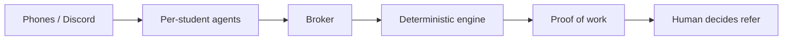

# Hirearchy

**Hierarchical networking for students.** The networking ladder they actually need — early jobs, daily prep, a community that levels up together, and referrals earned by trust, not purchased.

**Live:** [hirearchy-agents.vercel.app](https://hirearchy-agents.vercel.app) · **App:** [/app/](https://hirearchy-agents.vercel.app/app/) · **Discord live:** `/app/?live=1`


## What Hirearchy is

Networking is how students get jobs. Not another resume keyword score. Not another autofill button. The warm path — someone who will vouch for you — is the path. And every tool students use today treats that as an afterthought.

We researched what already exists. Handshake gives you a job board and a campus directory. Simplify, Teal, and Huntr help you apply faster and track the chaos. Aced and interviewing.io help you practice mocks. Glassdoor and Blind dump anonymous intel. University platforms like PeopleGrove and UniBuzz match you to alumni for mentorship. And on the other extreme, marketplaces literally sell warm intros. Slices everywhere. One stack nowhere.

Nobody connects the hierarchy: **find the role early → prep with your pipeline → share intel → mentor and get mentored → build proof of work → earn the referral.** That’s the gap. That’s Hirearchy.

Hirearchy is hierarchical networking for students. You don’t buy your way up. You climb. Help a beginner, earn more points. Climb levels. Unlock reach, packs, a stronger mentor profile. Alumni who hire don’t trust a cold LinkedIn ask — they trust people who’ve already shown up for their community. Points don’t purchase referrals. Points make you visible and credible so when a human decides after a real chat, they already know your work.

And while you’re climbing that ladder, your agent is already hunting. We pull straight from Greenhouse, Ashby, Lever, and Workday-class boards — roles posted minutes ago, before they even hit LinkedIn. You apply while the stack is still short. Then every day the same product pulls you forward: prep circles for the real invite, mock swaps with someone in your round, give-to-get intel for your pipeline, community help that compounds your standing, and a referral bridge where an alum’s agent fit-checks your anonymous proof of work — and only the human clicks Refer.

Privacy is built in. Names stay hidden until both sides say yes. Agents match and gatekeep; students and alumni keep the decisions.

**One line:** the networking ladder students actually need — early jobs, daily prep, a community that levels up together, and referrals earned by trust, not purchased. No app does this end to end.

## How this fits Track 2

Track 2: personal AI agents for campus life that **work with each other**, exchange what matters, and reach a shared outcome — showing **conflicting constraints**, **what is shared**, and **when humans confirm**.

| Track ask | Hirearchy |
|---|---|
| Real campus scenario | Job-hunt networking: peers prep together, juniors get help, alumni vouch — the hierarchy of a campus career community |
| Agents work with each other | One agent per student; broker relays anonymized listings; agents negotiate times, capacity, and fit |
| Conflicting constraints | Different evening windows, pipelines, mentor capacity, monthly referral limits, “must meet first” |
| What they share | Anonymized skills / stage / intel; names locked until mutual consent; ratings never leak as singles |
| When students confirm | Join, share stats, reveal identity, confirm a session, **Refer** |
| Messaging | iMessage-style UI; optional real Discord DMs (`?live=1`) |
| Open stack | React, TypeScript, Vite; deterministic in-repo engine — not Cubbie |

In the app, **How it works** (Prep circle + Referral) highlights those three lenses on the agent feed.

## Product map

| Area | Role on the ladder |
|---|---|
| **Find · Apply · Applications** | Early board jobs; tailored resume; one record per job with readiness nudges |
| **Prep circle · Mock · Intel** | Same-pipeline practice and give-to-get intel → proof of work |
| **Community** | Help up / climb levels (3× for newcomers); reach, packs, mentor profile — not a referral shop |
| **Referral** | Staged anonymous proof → coffee chat → only the human taps Refer |
| **Trust** | Prep, mocks, intel, mentoring feed one private evidence file |

## Multi-agent design

- Each student has an agent with **private** profile, policy, and rules.
- The **broker** only sees anonymized listings and relays structured events.
- **Deterministic code** decides match, schedule, fit, limits, and consent. An optional LLM only words messages.
- **IdentityVault**, rating ledger, and mock score vault enforce privacy in data. `npm run test:sabotage` plants twelve leaks and requires the suite to catch each.



## Tech stack

React 19 · TypeScript · Vite · Vitest · Vercel · optional Anthropic (wording) · optional Discord + Supabase.

Paths: `src/engine/`, `src/features/`, `api/jobs-search.ts`, `src/live/` · [LIVE_DISCORD.md](LIVE_DISCORD.md) · [AUDIT.md](AUDIT.md)

## Run locally

```bash
npm install
npm run dev    # http://localhost:5173/  →  /app/
npm test
```

No API keys required for the core demo. Optional env: `.env.example`.

## Team

- **Sumedha** — engine, journey / Applications, prep, community, mock, trust, referral, live Discord  
- **Aditya** — Find, Ask, Pipeline, Intel, integrations
