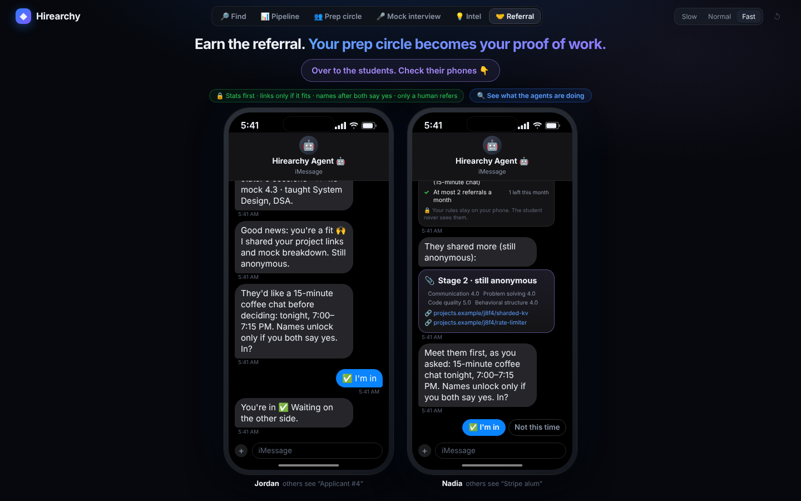
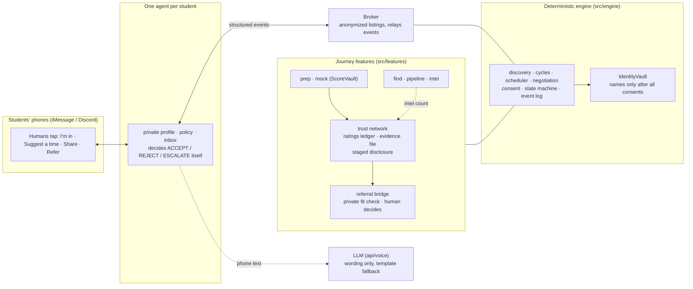

# Hirearchy: your agent for the whole job hunt

**Find the job. Prep with your pipeline. Earn the referral. Your agent negotiates; you decide.**

> **Your prep circle becomes your proof of work.**

Every student has a personal AI agent that lives in their messages. It finds jobs, finds other students in the same
hiring pipeline to prep and mock-interview with, trades interview intel anonymously, and turns all of that into a
private record that can earn a referral. Agents talk to each other through structured events and negotiate on
their own; **deterministic code decides everything** (matching, fit, limits, consent), the LLM only words messages,
and a human is asked before anything that matters: joining, sharing more, revealing a name, referring.


Students never see a graph. They see texts from their agent and tap **✅ I'm in**, **🕗 Suggest a time** or
**Not this time**. The agents' side sits behind **🔍 See what the agents are doing** on every tab, for judges.

## Site

- **`/`** is the landing page (`src/landing/`): the marketing site, ported from its Lovable build into React with its
  own compiled stylesheet (`src/landing/site.css`) and no extra dependencies.
- **`/app/`** is the live demo app (`app/index.html` → `src/main.tsx`). It uses the same design tokens, logo and buttons as
  the landing page; its logo links back to `/`.

## The journey

| Tab | What the agent does | Owner |
|---|---|---|
| 🔎 **Find** | Surfaces matching postings (Job Sniper); "Track it" puts you in that company's pipeline. **Live search** switch: real postings from 443 public company job boards | Aditya (seeded), Sumedha (live) |
| 📄 **Apply** | A resume tailored to one posting from your own bullets (LaTeX, Overleaf, PDF), intro email drafts you send yourself, contacts, tracker export | Sumedha |
| 📊 **Pipeline** | Anonymous stats for your pipeline, each published only once enough reports back it | Aditya |
| 👥 **Prep circle** | You landed an interview: finds 2–3 students whose skills cover your weak spots, negotiates a time, names after everyone says yes | Sumedha |
| 🌱 **Community** | Pay it forward: a newcomer with nothing to trade asks for help; a mentor's agent decides from private capacity rules; confirmed help earns points and levels (never a referral); question packs; a project board | Sumedha |
| 🎤 **Mock interview** | Swaps mock interviews with someone in the same company and round; scores go only to the person scored | Sumedha |
| 💡 **Intel** | Give-to-get interview reports, scrubbed of anything identifying | Aditya |
| 🤝 **Referral** | Your prep record, shared step by step, earns a coffee chat with an alum, who decides on the referral | Sumedha |

Prep circles and mocks feed a shared **trust network**: after each session members rate each other privately, and
each student gets a private **🏅 proof of work** (sessions, average rating, mock scores, skills taught, intel
reports). The Referral tab reads that record, so what you do in the other tabs really changes your referral.

## Apply suite: what's live and what's demo

| Feature | Live when | Otherwise | Notes |
|---|---|---|---|
| Live job search (Find → Live search) | Always on Vercel (public job-board APIs need no key) | Seeded postings, labelled "Demo data" | Official Greenhouse, Lever, Ashby and SmartRecruiters JSON endpoints only; 443 boards from Job Sniper, up to 60 per search |
| Visa and graduation screening | Always (on each posting's text) | n/a | F-1 friendly / needs verification / not eligible and the student's graduation window, each quoting the exact sentence; silence is never assumed friendly |
| Tailored resume (Apply) | Always (runs in the browser) | n/a | Uses only the student's own bullets and skills; lists requirements they don't meet. Starts on a labelled demo profile; paste or type your own |
| LaTeX / Overleaf / PDF | Always | n/a | `.tex` download, Overleaf's documented "open in Overleaf" form, print to PDF; file name "Resume - <Company> - <Role>" |
| Intro email drafts | Always (template) | n/a | `ANTHROPIC_API_KEY` adds Claude rewording that may not add facts. Copy / Gmail / email app only: **we never send email** |
| Contacts | `APOLLO_API_KEY` set | Three contacts labelled "Demo data" | Name, title, company, LinkedIn. No emails from search |
| Huntr | n/a | n/a | **Huntr has no public integration for individual students** (its API is for career centres). Apply → Tracker keeps a status per job (Saved → Applied → OA → Interview → Offer / Rejected) with a summary and interview rate, exports CSV / JSON and links to Huntr |
| Referral packet | Always (demo network) | n/a | After the coffee chat is booked, the referrer can request Jordan's tailored resume + intro; shared only on Jordan's yes |

Research and sources for every integration: [AUDIT.md](AUDIT.md).

## How each feature maps to the judging criteria

The Prep circle, Mock interview and Referral drawers have the same three judging-lens chips; clicking one
highlights those events in the agent conversation: **⚠ Conflicting constraints** (CONFLICT / COUNTER / REJECT), **↗ What's shared** (every event lists
what was shared, abstracted and withheld) and **⏸️ When humans are asked** (ESCALATE / CONSENT). Find, Pipeline and Intel explain themselves in their own drawers
(**See why these matched**, **See what was shared and hidden**).


### 👥 Prep circle
| Criterion | What you see |
|---|---|
| **Conflicting constraints** | Three students with different evening windows (6:00–9:30, 7:00–9:00, 7:30–10:00 PM). The broker flags the conflict and the agents negotiate the 7:30–9:00 PM overlap. Applicant #6 rejects the evening on its own. Maya counters "8pm?", and every other agent checks 8:00–9:00 PM against its own private hours before it goes back to the humans; a counter that doesn't fit someone is rejected and the old time stands. |
| **What's shared** | Anonymized listings only. Maya's interview date becomes "time-sensitive prep need", Aditya's exact stage is withheld, Applicant #7 (`share_skills=false`) never publishes a listing, and names / emails / Discord ids stay withheld until everyone accepts. |
| **When humans are asked** | Agents settle the schedule themselves (`negotiate_schedule = true`). Joining and revealing identity always escalate. Names are revealed only after **all** members accept; if one declines, the circle dissolves without naming who left and the backup (Jordan) is invited. |

### 🎤 Mock interview
| Criterion | What you see |
|---|---|
| **Conflicting constraints** | Same company and round, at least 60 minutes free together, same difficulty, complementary weak spots first, then the more reliable partner. One agent skips a candidate on a private rule (never a third mock with the same person) without saying why. No one free in your round → practice with your own agent instead. |
| **What's shared** | Anonymous mock listings (round, strengths, weak spots, difficulty). A question pack from anonymized reports. Rubric scores go **only to the person scored** (`ScoreVault` throws for anyone else). |
| **When humans are asked** | Both say "I'm in" before anything is booked; names unlock after both say yes; each human ends their round and scores the other privately; then rates the session. |

### 🤝 Referral Bridge


| Criterion | What you see |
|---|---|
| **Conflicting constraints** | The alum's agent holds **private rules**: SWE / backend roles only, ≥ 2 sessions, rating ≥ 4.5, mock average ≥ 4.0, must meet first, max 2 referrals a month (1 left). A deterministic fit check shows ✓/✗ per rule. Theo (★ 4.3) fails the rating rule; after Jordan is referred, the monthly limit fails too. The 15-minute chat is negotiated by the engine scheduler (7:00–7:15 PM). |
| **What's shared** | Staged: **stage 1** anonymous stats → **stage 2** project links + mock rubric breakdown, only if the fit passes → **stage 3** names, only after both say yes to the chat. A declined seeker hears only "not right now": no rule, threshold or referrer name, and the referrer never learns theirs. |
| **When humans are asked** | The seeker OKs sharing at all; both OK the chat; after the chat **only the referrer's human** can choose 🤝 Refer / 🕗 Not yet (with a coaching note, e.g. "Do one more system design mock first.") / No. Agents never refer on their own (`decide()` is the only path and throws for anyone else). Referrers earn give-back credit. |

### 🌱 Pay it forward (Community)
| Criterion | What you see |
|---|---|
| **Conflicting constraints** | Priya has nothing to trade, so no circle forms; her need stays open. Each mentor's agent checks its human's **private capacity rules** (topics, newcomers per week, evenings only): Leo doesn't teach DSA, Sam already has 2 of 2 newcomers this week, Aditya fits at 7:30–8:15 PM. A mentor gets one ask at a time; higher-level askers are matched first. On the project board, the senior's private shortlist rules and a hard weekly hours cap decide who fits. |
| **What's shared** | The listing has a handle, company, round, topic and "this week": no name, no exact date. Capacity checks and shortlist decisions go only to the mentor's own agent. Names unlock through the engine's consent-gated identity vault after both say yes. Points never appear in the evidence file; referrers see "helped N newcomers" instead. |
| **When humans are asked** | Both humans say yes before anyone meets; both confirm the session happened before points count; both rate privately. Seniors pick, juniors choose to join and can leave anytime. |

### 🏅 Trust and proof of work (Prep circle + Mock interview)
| Criterion | What you see |
|---|---|
| **Conflicting constraints** | Reliability breaks ties in mock matching; a no-show counts against it. |
| **What's shared** | No individual rating is ever returned, not even to the person rated: only a count, and a reliability score once there are ≥ 2 ratings. The evidence file is readable only by its owner and leaves their agent only through staged disclosure. |
| **When humans are asked** | Each member rates the others privately after the session (showed up? helpful 1–5?). |

### 🔎 Find · 📊 Pipeline · 💡 Intel (Aditya)
| Criterion | What you see |
|---|---|
| **Conflicting constraints** | Find: postings against your role and level filters. Pipeline: you want numbers, but each stat stays hidden until it has ≥ 3 reports. Intel: give-to-get access versus a 48-hour grace period. |
| **What's shared** | Find: match reasons built from the posting, never your data. Pipeline: aggregate counts only; a hidden stat has no number at all. Intel: emails, phone numbers, @handles and exact dates are scrubbed; dates become "this week". |
| **When humans are asked** | Find: nothing is tracked until you tap "Track it". Intel: you choose to write a report and what goes in it. |

## Pay it forward

Newcomers have nothing to trade yet, so a prep circle can't form for them. In the **Community** tab their agent posts
a standing, anonymous help request instead, and mentors earn points and levels for helping.

**Points never buy a referral.** There is no way to spend points at all: they unlock perks by level (matching
priority, a badge on your proof of work, question packs), and `redeemForReferral()` exists only to refuse. A referral
still comes only from a referrer's own decision after a chat (Referral tab). What referrers can see is your mentoring
("helped 2 newcomers, ★ 4.8"), never your points, so helping others counts toward a referral without ever guaranteeing one.

| Rule | Why |
|---|---|
| Base 10 points; helping a newcomer 3x, someone a level below 2x, a peer 1x | Rewards helping people who have the least |
| Points only after **both** sides confirm the session happened | No points for a session that didn't happen |
| One pair earns points at most twice a week (either direction) | Two friends can't farm points off each other |
| Newcomer status ends after 3 completed sessions | The 3x bonus can't be farmed forever |
| Saying no never costs points | No pressure to accept; capacity rules stay private |
| Only the helper earns; a mentor gets one ask at a time | No points for being helped; no flooding a mentor |
| Levels: Newcomer 0, Contributor 30, Mentor 100, Senior mentor 250 | Perks only: priority, badge, packs (1, 3, all) |
| Projects: hours capped per junior per week; juniors leave anytime and keep their credit and points | Seniors can't overload juniors; leaving is free |

All of it is deterministic code (`src/features/community/points.ts`, `community.ts`, `projects.ts`); no model decides a
point, a match or an unlock. Question packs are copied word for word from the anonymized mock and intel reports, each
item labelled with its source; there is no pack for a company with no reports.

## Privacy proof

Privacy is enforced in the data layer, not just hidden in the UI. Names, emails and Discord ids live in an
`IdentityVault`, and the only way to read them is `getIdentity()`, which throws until every member has consented.
Ratings live in a ledger with no method that returns one. Mock scores live in a vault only the person scored can
read. The referrer's fit check is addressed to the referrer's agent only.

The badge in the app ("🔒 Privacy proof · … · N/N tests passing") comes from a real test run.

**Sabotage tests:** `npm run test:sabotage` plants a privacy bug, runs the whole suite, and requires the tests to
catch it, for twelve bugs, one at a time, restoring the code after each:

```
✓ caught   Broker names the decliner when dissolving
✓ caught   Broker reveals at 2 of 3 consents
✓ caught   Identity gate removed from the vault
✓ caught   Listing carries the private name
✓ caught   Interview date shared raw instead of abstracted
✓ caught   share_skills=false agent still publishes a listing
✓ caught   Rating leak: trust summary carries the individual ratings
✓ caught   Referral auto-approved by the agent after the chat
✓ caught   Evidence file (links + rubric) sent at stage 1, before the fit check
✓ caught   Mock scores readable by anyone, without the subject's grant
✓ caught   Outreach draft auto-sent without the student
✓ caught   Resume export adds skills the student never listed

All 12 privacy sabotages were caught.
```

## How to run

```bash
npm install
npm run dev            # landing page at http://localhost:5173/, demo app at /app/ (runs the tests first to refresh the badge)
npm test               # all unit tests
npm run demo:run       # prints the prep-circle golden path and the backup branch, no browser needed
npm run test:sabotage  # the privacy sabotage tests
```

Requires Node 20.19+ (or 22.12+). Everything runs in memory. No keys are needed locally: `npm run dev` doesn't
serve the `api/` functions, so notifications and Claude wording quietly fall back and the demo works end to end.

## Deployment (Vercel)

Import the repo into Vercel. The defaults work as they are: framework **Vite**, build command `npm run build`,
output `dist`. The serverless functions in `api/` are picked up automatically; there is no `vercel.json`.

| Function | Does | Needs | Without it |
|---|---|---|---|
| `api/voice.ts` | Words a phone message with Claude (only when `VITE_USE_LLM_COPY=true`) | `ANTHROPIC_API_KEY` | Responds 503; the browser uses a template within 3 s |
| `api/notify.ts` | Posts Aditya's "needs you" messages to Discord | `DISCORD_WEBHOOK_URL` | Responds 503; skipped silently |
| `api/jobs-search.ts` | Live search: reads up to 60 public job boards (7 s budget, 10 min cache) | nothing (set `JOBS_SEARCH=off` to disable) | The Find tab shows the seeded postings, labelled "Demo data" |
| `api/outreach-draft.ts` | Intro email draft; Claude rewording only if it adds no facts | `ANTHROPIC_API_KEY` (optional) | Template draft (always under 120 words) |
| `api/apollo-search.ts` | Recruiters and people in the target role at a company (Apollo People API Search) | `APOLLO_API_KEY` | Three contacts labelled "Demo data" |

### Environment variables

| Variable | Where | Required | Purpose |
|---|---|---|---|
| `ANTHROPIC_API_KEY` | Server (Vercel env) | Optional | Claude wording for phone messages via `/api/voice` |
| `DISCORD_WEBHOOK_URL` | Server (Vercel env) | Optional | Discord notification for Aditya's "needs you" messages via `/api/notify` |
| `APOLLO_API_KEY` | Server (Vercel env) | Optional | Real contacts in Apply → Outreach (Apollo's People API Search: 0 credits, no emails) |
| `OUTREACH_MODEL` | Server (Vercel env) | Optional | Claude model for outreach rewording (default `claude-sonnet-5-5`) |
| `JOBS_SEARCH` | Server (Vercel env) | Optional | `off` disables live job search |
| `VITE_USE_LLM_COPY` | Build time | Optional, default off | `true` = phone messages worded by Claude; off = the built-in student copy. Only turn on with `ANTHROPIC_API_KEY` set. Redeploy after changing it (it's baked into the build). |

### Live Discord mode (optional)

Open the demo app with `/app/?live=1` (`/?live=1` redirects there) and Aditya's agent really DMs them in Discord with **✅ I'm in · 🕗 Suggest a time ·
Not this time** buttons; their answer drives the demo exactly like a tap on their simulated phone. Without `?live=1`, or
if anything fails, the page says "Live mode unavailable, using simulated phone" and carries on. Full setup:
**[LIVE_DISCORD.md](LIVE_DISCORD.md)**. It adds three functions (`api/live-notify.ts`, `api/live-state.ts`,
`api/discord-interactions.ts`), one Supabase migration (`supabase/live.sql`) and these server-only variables:

| Variable | Secret? | Purpose |
|---|---|---|
| `DISCORD_APP_ID` | no | The Discord application |
| `DISCORD_PUBLIC_KEY` | no | Verifies Discord's signature on every interaction |
| `DISCORD_BOT_TOKEN` | **yes** | Sends the DM |
| `DISCORD_ADITYA_USER_ID` | no | The only person the bot DMs and accepts clicks from |
| `SUPABASE_URL` | no | Where replies wait for the page (`VITE_SUPABASE_URL` also works) |
| `SUPABASE_SERVICE_ROLE_KEY` | **yes** | Server-side access to the `t2_live_*` functions |

`VITE_SUPABASE_URL` / `VITE_SUPABASE_ANON_KEY` are listed in `.env.example` but not used yet:
`supabase/track2.sql` is written and not connected. Never commit real values; `.env*` files are git-ignored
except `.env.example`.

## Demo steps

The top bar has the speed control (**Slow** for a live presentation, **Fast** for a run-through) and **↺**, which
resets every tab at once. Tabs keep their state while you switch between them.

### 👥 Prep circle (default tab)
1. Pick **Slow** (top right) for a live presentation, or **Fast** for a quick run-through.
2. Click **📩 Aditya just got a Microsoft interview invite →**. Or click **Paste a real invite**, paste e.g.
   *"We would like to invite you to interview for the Software Engineer Intern role at Microsoft."* and press
   **Check invite**. (An invite for another company is recognised but doesn't start a run, since only the
   Microsoft SWE Intern network is seeded.)
3. Aditya's phone says congrats while the agent works. Open **🔍 See what the agents are doing** to watch it live:
   8 agents found → #8 filtered (other pipeline) → #7 invisible (private profile) → #5 filtered (same skill only)
   → #6 rejects the evening on its own → circle **You → #3 (DSA) → #2 (System Design) → You (Behavioral)**, #4
   held as backup → ⚠ schedules conflict → agents negotiate → ✓ window agreed, 7:30–9:00 PM. Close the drawer.
4. A notification slides down on all three phones. On **Maya's phone**, tap **🕗 Suggest a time → 8:00 PM**. The
   other agents check 8:00–9:00 PM against their private hours, and everyone gets the new time.
5. Tap **✅ I'm in** on all three phones. Names unlock 🔓, each phone gets a calendar invite with the circle, and
   **Add to calendar** downloads the .ics.
6. In the drawer, toggle the judging-lens chips to walk through each criterion. Click a "Shared · Summarized ·
   Hidden" line to see exactly what an agent disclosed.
7. Press the faint **↺** (top right) to reset, start again, and tap **Not this time** on Maya's phone for the
   backup branch: the circle dissolves, nothing is revealed, nobody is told who left, and Jordan's phone appears
   with a new circle at 7:00–9:00 PM.

### 🎤 Mock interview
Click **🎤 Aditya's Microsoft technical round is Thursday →**. Tap **✅ I'm in** on both phones; each gets a question
pack, the rounds run on a timer (**End round**), each scores the other privately, then rates the session and sees
their proof of work. **No one in your round?** shows the practice-with-your-agent fallback.

### 🤝 Referral
1. Click **🤝 Jordan applied to Stripe SWE Intern →**. On Jordan's phone tap **✅ Share my stats**.
2. Nadia's phone shows the anonymous stats, then the private fit check (✓ on every rule), then the project links and
   rubric. Both tap **✅ I'm in** for the 15-minute coffee chat; names unlock.
3. Nadia taps **☕ We had the chat**, then decides. **🕗 Not yet** opens a coaching note; **🤝 Refer** sends the
   referral, uses the last referral this month and earns +1 give-back credit.
4. **Next applicant: Theo →** keeps Nadia's month: Theo fails the rating rule (and the limit). Theo's phone only
   says "not right now". From the start screen, **Not a fit? See Theo's application** shows the rating failure alone.
5. **🔍 See what the agents are doing** shows the fit check per rule, which stage has been shared, and referrals left.

### 🌱 Community (Pay it forward)
1. Click **Priya, a freshman, needs help with DSA for Microsoft →**. Her agent explains that a circle needs something
   to trade, posts an anonymous request and gives her a free starter question pack. Leo's and Sam's agents pass on
   their own (open the drawer to see why); the request shows **Waiting for a mentor**.
2. Click **A mentor comes online →**. Aditya's agent checks his private rules (DSA, 0 of 2 newcomers this week,
   evenings) and asks him. With `?live=1` this is a real Discord DM: tap **I can help** or type yes.
3. Tap **I'm in** on Priya's phone. Names unlock and both get a calendar card for 7:30–8:15 PM.
4. Tap **We had the session** on both phones. Aditya earns **+30 (10 x 3, helped a newcomer)**, reaches
   **Contributor**, unlocks 3 question packs, and after both rate privately his proof of work shows the Contributor
   badge and "Helped 1 newcomer".
5. In the side card, **Trade points for a referral?** shows the rule: points can't buy one.
6. Switch to **Project board** and click **Sam posts a project**: three juniors apply anonymously, Sam's agent
   shortlists two (Riya is over the hours cap), Sam picks Priya, she joins, logs 4 hours, both confirm the week (Sam
   +30), then she leaves and keeps her credit and points.

### 📄 Apply and live search
1. Find → turn on **Live search** (top right), pick a level, **Search live boards**, then **Track** a posting. The agent
   offers the prep circle, a mock swap, a referral, or a tailored resume.
2. Apply → the tracked posting is selected: the phone says how many of your bullets it used and which requirements you
   don't show yet. **Download LaTeX**, **Open in Overleaf** or **Save as PDF**.
3. **Outreach** → **Find contacts**, pick one, **Write draft**, then Copy / Open in Gmail / Email app. **Tracker** →
   export CSV or JSON. **See what the agent is doing** lists every step with what was shared, summarized and hidden.
4. In Referral, after both say yes to the chat, Nadia can **Request resume and intro**; Jordan decides whether to share.

## Architecture



- **Agents and broker:** each student's agent holds its own private data and decides against it; the broker only
  sees anonymized listings and relays events. Nobody's agent reads another's private data.
- **Deterministic engine, reused by every feature:** matching, scheduling, negotiation, consent, identity and the
  state machines are plain, tested TypeScript. Each feature (mock, referral) has its own state machine on the same
  transition rules, and runs are reproducible (↺ restores every tab exactly).
- **Trust network:** one per journey, keyed by person, fed by prep circles and mocks, read by the referral bridge.
  It never returns an individual rating.
- **LLM only for language:** Claude (`api/voice.ts`, opt-in via `VITE_USE_LLM_COPY`) only words messages to
  humans. It never decides a match, a time, a fit, a limit or a consent. Templates by default; the demo works
  offline.

Code map: `src/engine/` (agents, broker, pure modules), `src/features/` (`prep`, `mock`, `trust`, `referral`;
Aditya's `find`, `pipeline`, `intel`), `src/ui/` (shared kit: iMessage phones, drawer, judge lenses, agent feed,
student copy), `src/live/` + `api/live-*` + `api/discord-interactions.ts` (live Discord mode),
`src/integrations/` + `api/voice.ts` + `api/notify.ts` (invite parsing, .ics, wording, notifications), `scripts/`
(`demo:run`, test badge, sabotage tests), `tests/`, `supabase/` (`track2.sql` written but not connected;
`live.sql` for live mode).

## Team

- **Sumedha:** coordination engine, journey shell, mock interviews, trust and proof of work, Referral Bridge
  (`src/engine/`, `src/app/`, `src/ui/`, `src/features/{prep,mock,trust,referral}/`, live Discord mode, `scripts/`)
- **Aditya:** integrations and deployment support, Find, Pipeline stats, Intel exchange
  (`src/integrations/`, `api/voice.ts`, `api/notify.ts`, `src/features/{find,pipeline,intel}/`)
